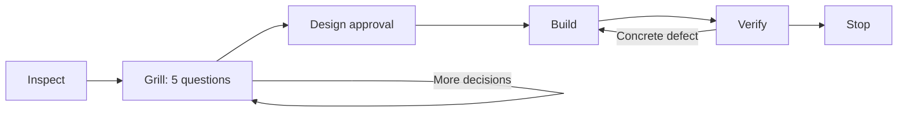

# GrillPower

**Five questions. One best recommendation each. Build only after approval.**

An AI skill for people who want their agent to challenge the plan before it writes the code — without endless reviews or improvement loops.

[](https://github.com/clipcraftclients-art/grillpower/releases)
[](https://github.com/clipcraftclients-art/grillpower/stargazers)
[](https://agentskills.io/specification)

[](LICENSE)

[Install](#install) · [See it in action](#see-it-in-action) · [How it works](#how-it-works) · [Compatibility](COMPATIBILITY.md)

## Install

```bash
npx skills add clipcraftclients-art/grillpower --skill grillpower
```

Or copy [PROMPT.md](PROMPT.md) into an AI chat. The optional installer requires Node.js and network access; the skill itself has no runtime dependencies. [Manual installation and agent-specific guidance](COMPATIBILITY.md).

## See it in action

Say: **"Use GrillPower to help me build a new feature in my project."**

The agent inspects your codebase and asks five important questions together. For example, assume an existing application with a working codebase, established conventions and a limited development budget.

**Q1 — Implementation approach**
- A. Extend the existing codebase **(Recommended)**
- B. Build a separate module
- C. Replace the existing architecture

Why: extending a suitable codebase avoids unnecessary migration and preserves working features.

**Q2 — Feature scope**
- A. Build every proposed feature at once
- B. Implement the essential functionality first **(Recommended)**
- C. Build a prototype before implementation

Why: a focused scope reduces complexity and makes the first implementation easier to verify.

**Q3 — Dependencies**
- A. Reuse existing libraries where suitable **(Recommended)**
- B. Introduce a new third-party library
- C. Develop a custom solution

Why: existing dependencies reduce integration overhead when they meet the requirements.

**Q4 — Compatibility**
- A. Allow breaking changes
- B. Preserve existing behavior and interfaces **(Recommended)**
- C. Introduce a versioned replacement interface

Why: preserving compatibility reduces regression and migration risks.

**Q5 — Testing strategy**
- A. Manual testing only
- B. Focused automated tests and relevant regression checks **(Recommended)**
- C. A comprehensive new test suite

Why: targeted checks provide useful evidence without unnecessary testing overhead.

Reply `1A, 2B, 3A, 4B, 5B` or **accept all**. The next round adapts to your answers. Recommendations depend on your actual project, not a fixed framework, language or architecture.

This example is illustrative, not a live benchmark. GrillPower applies the same workflow to websites, mobile apps, APIs, libraries, CLI tools, refactors, debugging and other projects.

## How it works



- **Inspect:** resolve what can be learned from existing evidence.
- **Grill:** five meaningful questions, 2–4 choices, exactly one project-specific recommendation per question.
- **Agree:** confirm scope, design and observable acceptance criteria before building.
- **Build:** execute approved work, focused tests and one consolidated review.
- **Verify:** show real evidence, repair only concrete defects and stop.

No mandatory improvement cycles. No automatic extra agents. No filler questions. No made-up test results.

## Why GrillPower?

[Grill Me](https://github.com/mattpocock/skills) emphasizes deep interviews. [Superpowers](https://github.com/obra/superpowers) emphasizes engineering discipline. GrillPower is an independent workflow inspired by both, designed around batched decisions, one clear recommendation and bounded execution. It is not affiliated with either project.

| Capability | GrillPower |
|---|---|
| Question batches | Five by default; shorter final round |
| Recommendation | One best feasible choice, based on your project |
| Partial replies | Stable question IDs and option mappings |
| Decision continuity | Optional ledger and resumable checkpoints |
| Engineering | Approval gate, focused tests, two-lens consolidated review |
| Usage control | No automatic improvement cycles or needless delegation |

## Works with your AI

Native routes are documented for Codex, Claude Code, Antigravity, Cursor, Gemini CLI, Copilot and OpenCode. Chat assistants and local models can use the universal prompt. Actual execution depends on host capabilities.

[Compatibility](COMPATIBILITY.md) · [Examples](examples/README.md) · [Evaluation](references/evaluation.md) · [Changelog](CHANGELOG.md)

## Verify or contribute

Run `python3 validate.py` for offline structural checks. Live behavior, installer execution and token savings remain unmeasured. [Behavioral test scenarios](references/pressure-tests.md) and [comparison protocol](references/evaluation.md) are available to reproduce evaluations fairly.

If GrillPower helps your project, consider starring the repository or sharing a reproducible before/after example. [Report an issue](https://github.com/clipcraftclients-art/grillpower/issues) · [Contributing](CONTRIBUTING.md).

## License

[MIT](LICENSE) © 2026 ZYRO.
