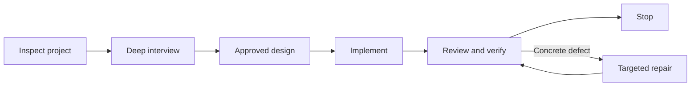

# GrillPower

**Make your AI ask better questions before it writes a single line of code.**

Deep interviews. Hard trade-offs. Approved designs. Tested implementation. No endless improvement loops.


GrillPower is a standalone AI coding skill inspired by [Grill Me](https://github.com/mattpocock/skills) and [Superpowers](https://github.com/obra/superpowers). It combines an adaptive design interview with disciplined execution and verification. It is an independent synthesis, not an official fork of either project.

## The problem

Coding agents often implement a plausible solution before the requirements are clear. The result can be rework, wasted usage, and features that pass tests but miss the intended outcome.

GrillPower makes consequential decisions explicit **before** implementation. After approval, it focuses on completing the agreed scope rather than running arbitrary improvement loops.

## How it works



| Capability | Behavior |
|---|---|
| Deep interview | One consequential question at a time; typically 12–25 or more for complex work |
| Recommended answers | Evidence, rationale and alternatives for each question |
| Decision ledger | Retains confirmed choices and delegated decisions |
| Critical review | Challenges contradictions and weak assumptions |
| Implementation | Autonomous within approved scope |
| Verification | Tests, regression checks and inspection of real outputs |
| Usage discipline | No fixed improvement cycles or speculative polishing |

## Quick start

For a host that discovers skills under `~/.agents/skills` (including compatible Codex setups):

```bash
git clone https://github.com/clipcraftclients-art/grillpower.git "$HOME/.agents/skills/grillpower"
```

For Claude Code, use its personal skill directory if supported:

```bash
git clone https://github.com/clipcraftclients-art/grillpower.git "$HOME/.claude/skills/grillpower"
```

For Antigravity or another coding agent, clone or download this repository and place the skill in your installed version's recognized skill directory. Keep `SKILL.md` and `references/` together. Alternatively, attach the files and explicitly request that the agent read them. Restart/reload skill discovery if necessary.

Then say:

> Use GrillPower. Investigate my project, challenge my assumptions, ask one consequential question at a time, and recommend an answer to every question. Once all important decisions are resolved, present the design for my approval. After approval, implement and verify it.

Slash commands and skill discovery vary by host; no particular integration is guaranteed. No API keys or additional skill frameworks are required. The optional validator requires Python 3.

## Example conversation

**You:** Build a new feature that lets customers export reports.

**GrillPower: Q1 — Export scope**

- **Question:** Should exports use the current filtered view or the complete dataset?
- **Why it matters:** The wrong default can leak unintended records or confuse users.
- **Recommended answer:** Export the authorized filtered view by default; make full export a separate, explicit action if required.
- **Alternative:** Always export the full dataset, which is simpler but may violate expectations.

You can accept, disagree, or delegate the decision. The next question uses your answer. The agent does not begin implementation until you approve the complete design.

## Designed to conserve usage

Deep thinking is not free. GrillPower spends effort where design decisions are consequential, then uses one focused implementation pass, one consolidated review, essential verification, and targeted repairs only when needed. No promise of token savings is made without measurements.

## What's included

- [SKILL.md](SKILL.md) — full workflow
- [Deep review checklist](references/deep-review.md) — architecture, security, operations, UX, and optional animation/media quality
- [Pressure tests](references/pressure-tests.md) — reproducible behavioral evaluation scenarios
- [Validator](validate.py) — lightweight static checks

Run `python3 validate.py` from a checkout named `grillpower` to validate the skill structure. Static checks do not prove model compliance or superiority to other skills. Live agent benchmarks are pending.

## Contribute

Try the skill on a real project. Share concrete examples, missing cases, or reproducible failures through [Issues](https://github.com/clipcraftclients-art/grillpower/issues). Include the agent, version, expected behavior and actual behavior; redact secrets and private code.

If it helps you avoid an expensive wrong turn, consider starring the repository.

## Credits

Inspired by Matt Pocock's [skills](https://github.com/mattpocock/skills) and Jesse Vincent's [Superpowers](https://github.com/obra/superpowers). No affiliation or endorsement is implied.
