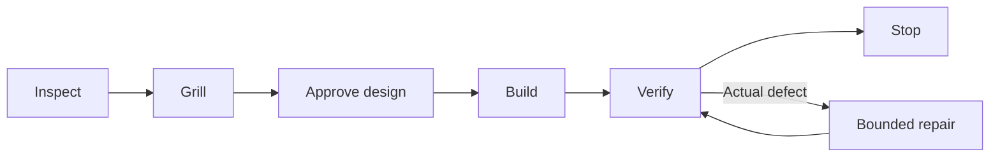

# GrillPower

**Stop letting your AI build the wrong thing.**

A universal deep-interview skill that turns uncertain ideas into approved designs, then builds and verifies them without endless improvement loops.

[](https://github.com/clipcraftclients-art/grillpower/releases)
[](https://github.com/clipcraftclients-art/grillpower/stargazers)
[](#installation)

[Install](#installation) · [Try it](#try-it) · [All agents](COMPATIBILITY.md) · [Universal prompt](PROMPT.md) · [Evaluation](references/evaluation.md)

## Installation

```bash
npx skills add clipcraftclients-art/grillpower --skill grillpower
```

Choose your agent in the installer. Requires Node.js and network access only for this optional third-party install method. Review its proposed destination and permissions. The skill itself has no runtime dependencies.

**No skill installer?** Copy [PROMPT.md](PROMPT.md) into ChatGPT, Claude, Gemini, Grok, DeepSeek, a local model, or any assistant that accepts instructions. For native manual installation, place `SKILL.md` and `references/` in your agent's recognized `grillpower/` directory. [Full compatibility guide →](COMPATIBILITY.md)

## Try it

> Use GrillPower. Grill me on my idea until we've resolved every important decision. Recommend an answer to each question. Don't build until I approve the design.

Then give it a real idea, feature, refactor, project or creative brief.

## What changes?

Illustrative example, not a recorded benchmark.

**You:** Add a button that exports our reports.

| Without a clear decision | With GrillPower |
|---|---|
| The agent immediately creates an export endpoint. | It first asks whether exports include filtered, authorized records or the full dataset. |
| You discover later that permissions and file size were never considered. | It recommends filtered export, explains the privacy and resource trade-offs, and asks you to choose. |
| You spend another session fixing the wrong assumptions. | It records your decision, asks the next material question, and waits for design approval before implementation. |

The goal isn't more AI output. It's fewer expensive wrong turns.

## How it works



**Grill deeply:** one consequential question per turn; recommendation, rationale, alternative, and an adaptive follow-up. Complex work may need many questions. The count is not a quota.

**Decide clearly:** a compact decision ledger, shared terminology, assumptions, non-goals, testable acceptance criteria and an explicit approval gate.

**Build efficiently:** autonomous implementation within scope, root-cause debugging, one consolidated review and targeted tests. No fixed improvement cycles, forced subagents or speculative polishing.

**Verify honestly:** actual tests or artifact inspection, acceptance evidence, blockers and unrun checks. Chat-only assistants provide plans and drafts rather than pretending they executed tools.

## Works beyond coding

| Use case | What GrillPower challenges |
|---|---|
| Software and architecture | Interfaces, migration, edge cases, security, testability |
| Product and business | User needs, trade-offs, scope, feasibility, success measures |
| Creative and video | Style references, pacing, constraints, render and output quality |
| Research and data | Source credibility, assumptions, methods and uncertainty |
| Automation | Triggers, permissions, recovery, resource limits |

Native skill routes are documented for Codex, Claude Code, Antigravity, Cursor, Gemini CLI, Copilot and OpenCode. Other agents can use the complete plain-text prompt. [Compatibility and installation](COMPATIBILITY.md). Host support and actual model behavior vary.

## What makes it different?

GrillPower is deliberately one deep workflow, not a collection of competing modes. It combines a decision interview, explicit design approval, scope-limited implementation and evidence-backed completion. It's inspired by [Matt Pocock's skills](https://github.com/mattpocock/skills) and [Superpowers](https://github.com/obra/superpowers), not affiliated with them or a measured replacement for them.

Deep interviews cost tokens. The design aims to avoid rework and unnecessary execution after approval; savings are not yet measured.

## Examples and evaluation

- [Example conversations](examples/README.md) — software, research and creative work.
- [Behavioral scenarios](references/pressure-tests.md) — test the skill against pressure, missing tools and interrupted sessions.
- [Evaluation rubric](references/evaluation.md) — compare a baseline agent and GrillPower using the same tasks.
- [Decision ledger template](templates/decision-ledger.md) — optional portable handoff.
- [Changelog](CHANGELOG.md) — version history.

Run `python3 validate.py` for offline structural checks (Python 3 only). Structural checks do not establish model compliance. Live multi-agent evaluations, comparative results and token savings remain unmeasured.

## Help improve GrillPower

If the skill helps you avoid a wrong turn, consider starring the repository. Share reproducible failures and useful examples via [Issues](https://github.com/clipcraftclients-art/grillpower/issues). See [Contributing](CONTRIBUTING.md) for a concise bug-report format. Please redact private code and secrets.

GrillPower is an instruction package, not an agent runtime. It does not grant permissions, execute background work or require API keys. It respects the host's actual capabilities.
